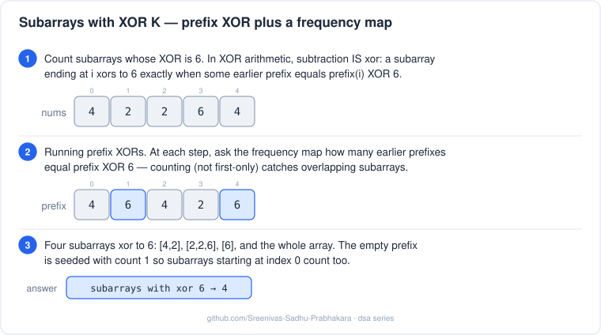

# Count Subarrays with Given XOR K

> Striver SDE Sheet 023 · Day 4 Arrays — prefix-XOR frequencies: a subarray XORs to k exactly when its two bracketing prefixes differ by k. Go, stdlib only, tested.

## Problem

Count the contiguous subarrays whose elements XOR to a given value k. The O(n²) scan of all subarrays is the baseline to beat.

## Approach

Same prefix trick as zero-sum subarrays, but in XOR arithmetic, where subtraction *is* XOR. Let `px(i)` be the XOR of everything up to i. A subarray (j, i] XORs to k exactly when `px(j) = px(i) ^ k`. So while scanning, keep a frequency map of all prefix XORs seen; at each position add how many earlier prefixes equal `current ^ k`. Counting (not just remembering first occurrence) is what captures *all* qualifying subarrays, including overlapping ones. The empty prefix is seeded with count 1 so subarrays starting at index 0 are counted.

**Complexity:** O(n) time, O(n) space.

## Visual walkthrough

Read the picture top to bottom — each numbered frame is one moment of the algorithm
running on this repo's test example.

## Run

    go test ./...   # verify
    go run .        # demo

---

One of 191 repos solving Striver's SDE Sheet in Go — stdlib only, one problem per repo, every solution tested. Browse the set: [`dsa-*` repos](https://github.com/Sreenivas-Sadhu-Prabhakara?tab=repositories&q=dsa-&type=source).
